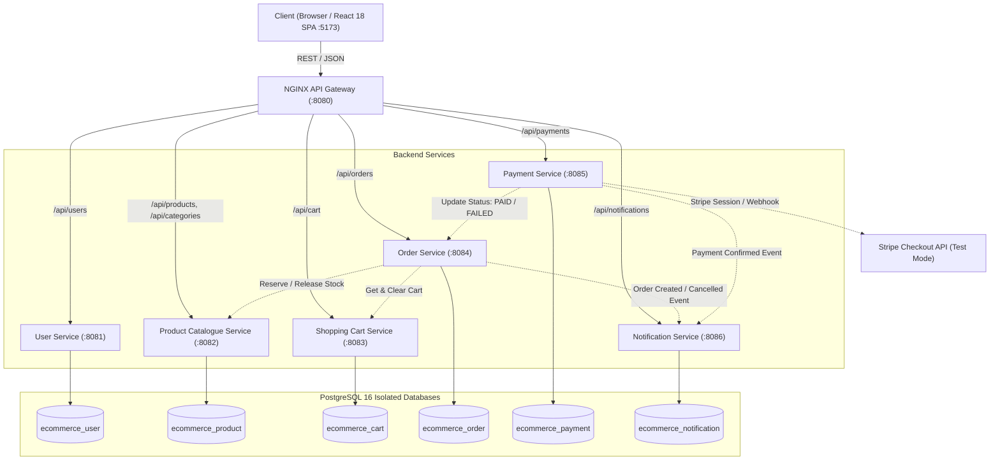
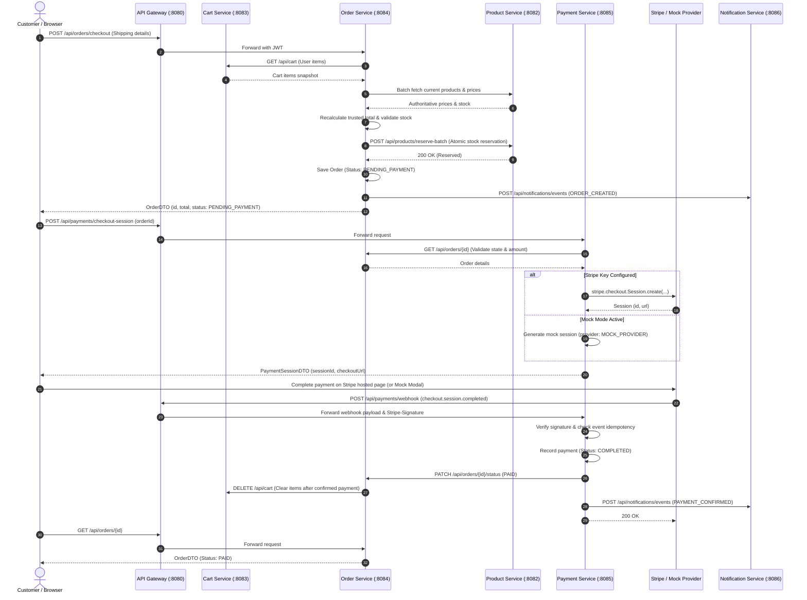

# Architecture & Design Specification
## Aura Luxury E-Commerce Platform

---

### 1. High-Level System Architecture

Aura E-Commerce follows a production-grade, distributed **Microservices Architecture**. All external HTTP traffic flows through an **NGINX API Gateway** operating as a single reverse proxy entrypoint on port `8080`. Stateful microservices own their private PostgreSQL databases, enforcing strict database isolation with zero cross-database queries.



---

### 2. Service Responsibilities & Boundary Definition

| Microservice | Port | Database | Primary Responsibilities |
|---|---|---|---|
| **User Service** | `8081` | `ecommerce_user` | Customer registration, BCrypt password hashing, JWT minting & validation, profile management, role-based authorization (`CUSTOMER`, `ADMIN`). |
| **Product Service** | `8082` | `ecommerce_product` | Catalogue management, category hierarchies, search, pagination, stock tracking, atomic database-level inventory reservations and compensations. |
| **Cart Service** | `8083` | `ecommerce_cart` | Persistent shopping carts per user, item additions/updates/deletions, server-side calculated totals, product existence validation. |
| **Order Service** | `8084` | `ecommerce_order` | Multi-service checkout orchestration, recalculating trusted prices, creating immutable purchase snapshots, managing order state transitions, triggering inventory compensations on failure. |
| **Payment Service** | `8085` | `ecommerce_payment` | Stripe Checkout session creation, cryptographically verified webhook processing (`STRIPE_WEBHOOK_SECRET`), idempotent transaction logging, local mock payment mode for testing. |
| **Notification Service** | `8086` | `ecommerce_notification` | Ingests asynchronous domain events (`ORDER_CREATED`, `PAYMENT_CONFIRMED`, `PAYMENT_FAILED`, `ORDER_SHIPPED`), deduplicates notifications, logs formatted audit records. |

---

### 3. Concurrency Safety & Atomic Inventory Reservation

To prevent overselling stock during high-traffic checkout events (e.g., flash sales), the platform utilizes **Atomic Conditional Database Updates** directly at the PostgreSQL row level rather than in-memory locks or naive read-then-write updates.

#### Atomic Reservation Query:
```sql
UPDATE products
SET stock_quantity = stock_quantity - :quantity,
    updated_at = :now
WHERE id = :id AND stock_quantity >= :quantity;
```
If the affected row count is `0`, the service recognizes that stock was exhausted between item selection and checkout, immediately rolling back the order and returning an `INSUFFICIENT_STOCK` conflict response (HTTP 409).

#### Compensating Release Action:
When an order expires, is canceled, or payment processing fails, the Order Service executes a compensating rollback on the Product Service:
```sql
UPDATE products
SET stock_quantity = stock_quantity + :quantity,
    updated_at = :now
WHERE id = :id;
```

---

### 4. End-to-End Checkout & Payment Workflow



---

### 5. API Gateway Path Routing Matrix

All client requests target `http://localhost:8080`. NGINX strips CORS headers, validates payloads up to 20MB, injects `X-Forwarded-*` headers, and routes explicitly:

| Route Prefix | Upstream Target Service | Target Internal URL |
|---|---|---|
| `/api/users/**` | User Service | `http://user-service:8081/api/users/**` |
| `/api/products/**` | Product Service | `http://product-service:8082/api/products/**` |
| `/api/categories/**` | Product Service | `http://product-service:8082/api/categories/**` |
| `/api/cart/**` | Cart Service | `http://cart-service:8083/api/cart/**` |
| `/api/orders/**` | Order Service | `http://order-service:8084/api/orders/**` |
| `/api/payments/**` | Payment Service | `http://payment-service:8085/api/payments/**` |
| `/api/notifications/**` | Notification Service | `http://notification-service:8086/api/notifications/**` |
| `/` (Fallback) | Frontend (Nginx/Vite) | `http://frontend:80` |

---

### 6. Interactive API Documentation (OpenAPI / Swagger UI)

Every microservice exposes an interactive OpenAPI specification and Swagger UI:

- **User Service:** `http://localhost:8080/api/users/swagger-ui/index.html` (or port `8081`)
- **Product Service:** `http://localhost:8080/api/products/swagger-ui/index.html` (or port `8082`)
- **Cart Service:** `http://localhost:8080/api/cart/swagger-ui/index.html` (or port `8083`)
- **Order Service:** `http://localhost:8080/api/orders/swagger-ui/index.html` (or port `8084`)
- **Payment Service:** `http://localhost:8080/api/payments/swagger-ui/index.html` (or port `8085`)
- **Notification Service:** `http://localhost:8080/api/notifications/swagger-ui/index.html` (or port `8086`)
